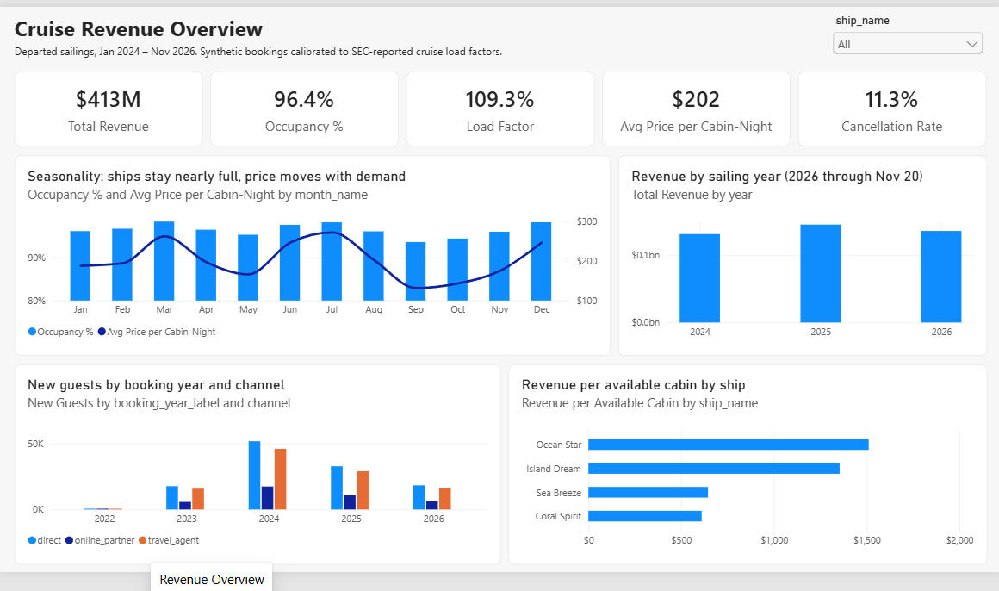
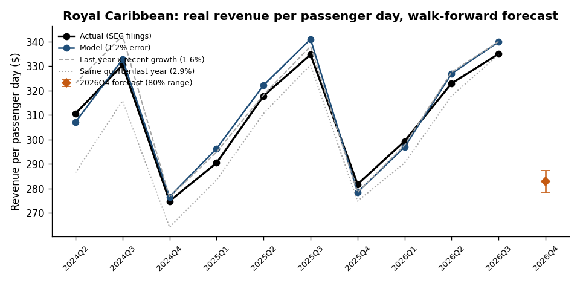
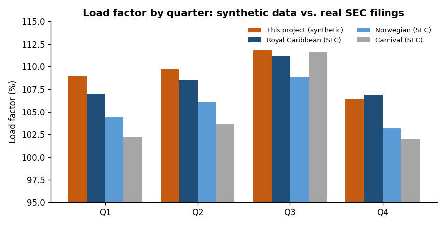
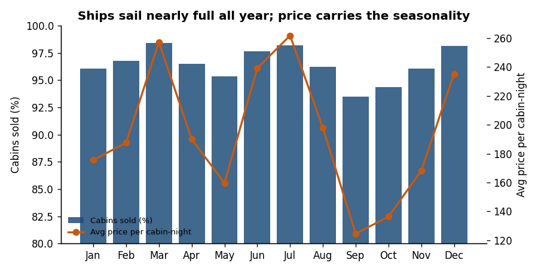
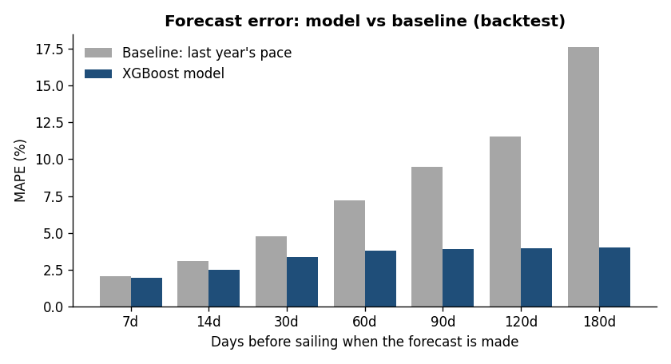
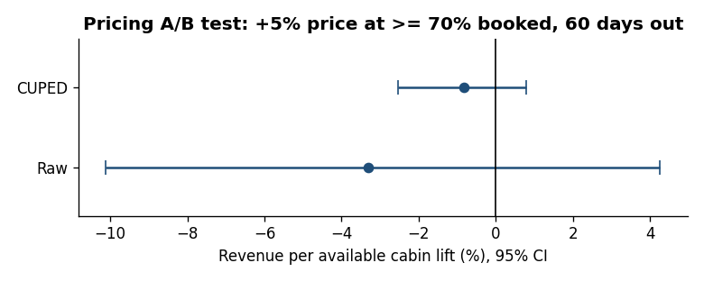
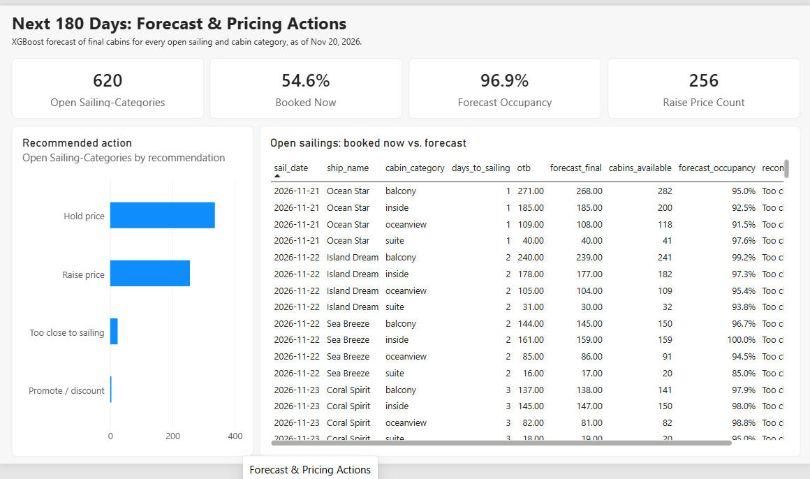
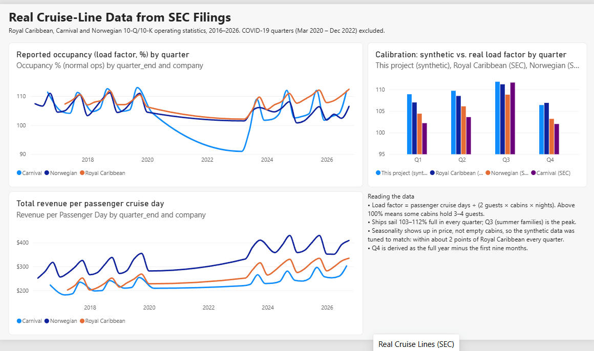
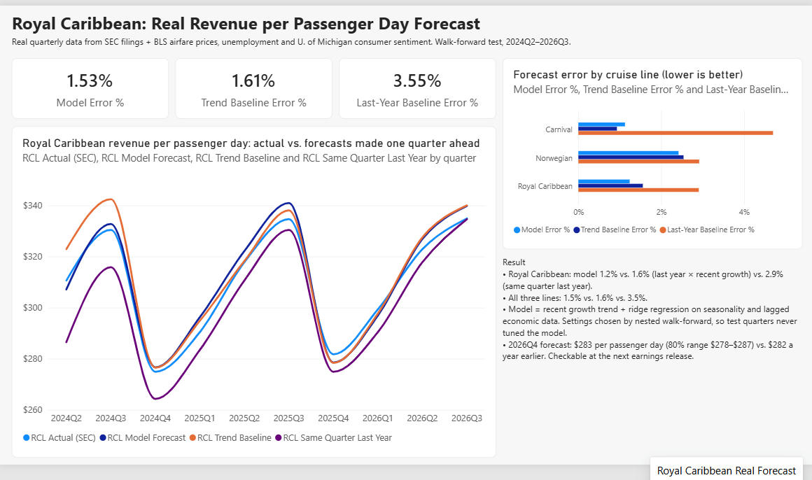

# Cruise Cabin Pricing & Demand Forecasting

An end-to-end revenue management project for a cruise line:
- an ETL pipeline that cleans 510K bookings,
- a SQL reporting layer,
- an XGBoost demand forecast that beats a "last year's pace" baseline,
- a pricing A/B test with CUPED variance reduction and a power analysis,
- price recommendations for upcoming sailings,
- a **real-data forecast** of Royal Caribbean's quarterly revenue per passenger day,
- a **6-page Power BI dashboard** (`powerbi/CruiseRevenue.pbip`), and a weekly automated refresh.

> **Data note:** booking-level data is **synthetic**, because cruise lines don't publish it. It's generated by `src/generate_data.py` and **calibrated to real quarterly numbers from Royal Caribbean, Carnival and Norwegian SEC filings** (see below). No real booking data from any cruise line is used, and the project isn't affiliated with any company.
>
> **Full list of sources, companies, SEC CIKs, BLS series, processing steps and sample rows: [docs/DATA_SOURCES.md](docs/DATA_SOURCES.md).**

## Results

| | Result |
|---|---|
| **Real-data forecast** | On Royal Caribbean's **actual** quarterly revenue per passenger day (SEC filings + BLS and U. of Michigan economic data), the model's error is **1.2%** vs. 1.6% for a trend baseline and 2.9% for same-quarter-last-year, tested walk-forward on 2024Q2–2026Q3. **2026Q4 forecast: $283** (80% range $278–$287) |
| Real-data calibration | Load factor within **~2 points of Royal Caribbean's SEC-reported quarterly occupancy** (109.2% vs 108.4% for the year; Q3 peak 111.8% vs 111.2%), using 100+ quarters of 10-Q/10-K data from three cruise lines |
| Data cleaned | **510,409 raw → 509,320 clean bookings**: 1,019 duplicates and 70 invalid rows removed, 2,546 category labels standardized, 509 missing prices filled |
| Demand forecast (backtest on the last 6 months of sailings) | **3.3% MAPE vs 8.0%** for the last-year-pace baseline (**58% lower error**) |
| Forecast 180 days out | **4.0% vs 17.6%** MAPE. The model's advantage grows with the forecast horizon |
| Pricing A/B test (+5% price when a cabin category is ≥70% booked at 60 days) | **No significant lift**: CUPED −0.54%, 95% CI −1.9% to +0.8%, p = 0.43, across 442 sailings. Decision: don't roll out broadly |
| Variance reduction | **CUPED cut variance by 93%**. The minimum detectable lift is about 1.9% with 442 sailings |
| Seasonality | Ships sell **93–98% of cabins every month**, while the average price per cabin-night swings from about **125 in September to about 260 in July**. Like the real cruise lines, demand shows up in price, not in empty cabins |
| Pricing insight (SQL) | After controlling for cabin mix, last-minute guests on **peak** sailings pay ~7% more than early bookers, while **low-season** last-minute fares are ~5% lower |
| Recommendations | Each of the next 180 days' sailings × cabin categories: *raise price / hold / promote* |
| Power BI | A 6-page dashboard: revenue overview, forecast & pricing actions, model accuracy, real SEC data, and the A/B test |









## How it works

```
sec_cruise_data ─▶ outputs/sec_cruise_quarterly.csv   (real 10-Q/10-K numbers, run on demand)
generate_data ─▶ data/raw/*.csv   (calibrated to those numbers)
      │
      ▼
etl (pandas) ─▶ data/clean/*.parquet  ─▶ (optional) S3 + Athena
      │              partitioned by sail_year
      ├─▶ sql_reports (DuckDB SQL on Parquet) ─▶ occupancy, customer acquisition, price by booking window
      ├─▶ calibration ─▶ synthetic vs. real load factor by quarter
      ├─▶ features ─▶ forecast (baseline vs XGBoost, time-based backtest) ─▶ forecast + recommendations
      ├─▶ experiment (A/B test, CUPED, power analysis)
      └─▶ export_powerbi + figures ─▶ outputs/powerbi/*.csv, outputs/figures/*.png
```

### 1. Data (`src/generate_data.py`)
The generator covers 4 ships and 1,091 sailings (Jan 2024–Jun 2027), with a snapshot date of 2026-11-20. Sailings after that date are only partly booked, just like the real world.

**Calibrated to real cruise lines:**
- Ships sail nearly full all year (load factor around 107–112%, above 100% because some cabins hold 3–4 guests).
- More families travel in summer and holiday weeks, so there are more guests per cabin, which is why real load factors peak in Q3.
- Seasonality shows up mainly in **price**: low-season sailings fill by discounting, not by sailing empty.

**Demand:**
- seasonality: peaks in Mar, Jun–Jul and Dec; lows in Sep–Oct
- holiday weeks
- year-over-year growth

**Booking curve:** the gap between booking and sailing follows a gamma distribution. Suites and 7-night cruises book earlier.

**Dynamic pricing:** strong sailings get pricier close to departure, and weak ones get discounted.

**Other details:**
- promotions: Wave season, Black Friday, past guests
- channels and source markets
- cancellations, which vary by channel

**Deliberately messy data, to test the ETL:** duplicates, missing and negative prices, bookings dated after the sailing, and inconsistent category text.

### Real cruise-line data (`src/sec_cruise_data.py`, `src/calibration.py`)
Cruise lines don't publish booking-level data, but every **10-Q and 10-K** reports operating statistics: passengers carried, passenger cruise days (PCD), capacity (APCD / ALBDs / capacity days) and occupancy. The script downloads **Royal Caribbean, Carnival and Norwegian** filings since 2016 from SEC EDGAR, parses those tables, and builds a quarterly dataset (`outputs/sec_cruise_quarterly.csv`, 102 quarters).
- **Q4** isn't reported on its own, so it's calculated as the full year minus the first nine months.
- **Revenue** comes from the SEC's XBRL API. The XBRL tag changed in 2018, so several tags are combined.
- **Quality check:** a row is dropped if its reported occupancy doesn't equal PCD ÷ capacity. One misread row was caught this way.
- **Mar 2020 – Dec 2022** (COVID-19 suspension and ramp-up) is flagged and left out of averages.

For the details, including every source URL, the field definitions, the 10-step build and real sample rows, see **[docs/DATA_SOURCES.md](docs/DATA_SOURCES.md)**.

`src/calibration.py` compares the synthetic load factor with those real quarters. The generator was tuned until every quarter was within about 2 points of Royal Caribbean's.

### Real-data forecast (`src/real_forecast.py`)
The synthetic bookings show the method. This model is tested on **real numbers**: it forecasts each cruise line's **total revenue per passenger cruise day** for the next quarter.

**Data, all public:**
- the SEC quarterly dataset above
- **BLS** airline-fare CPI and the unemployment rate
- **University of Michigan** consumer sentiment

The economic data is averaged per quarter and **lagged one quarter**, so the model only uses what was known before the quarter began. `outputs/macro_monthly.csv` keeps a copy in case a source is down.

**Models:**
- Baseline 1, **same quarter last year**.
- Baseline 2, **last year × last quarter's year-over-year growth**.
- **Model:** the recent growth trend (damped) plus a ridge regression on seasonality, company and the lagged economic indicators. It's pooled across all three cruise lines, because real data is small (about 50 usable quarters after excluding COVID-19).

**Validation:** walk-forward, one quarter at a time, 2024Q2–2026Q3. The ridge strength and damping are chosen by **nested walk-forward**, using only earlier quarters, so the test quarters never tuned the model.

| Error (MAPE) | Same quarter last year | Last year × recent growth | **Model** |
|---|---|---|---|
| Royal Caribbean (10 quarters) | 2.9% | 1.6% | **1.2%** |
| All three lines (28 quarters) | 3.6% | 1.6% | **1.5%** |

**What I learned:**
- A first, untuned ridge model **lost** to the simple trend baseline: 2.5% vs. 1.6%.
- Modeling the *adjustment* to the trend, instead of growth from scratch, is what beat it.
- With this little data, simple baselines are hard to beat. Every improvement has to be proven on quarters the model never saw.

### 2. ETL (`src/etl.py`)
Extracts the raw CSVs, then runs validation rules. Each rule's count is logged to `outputs/data_quality_report.md`:
- dedupe
- standardize text
- drop impossible dates and non-positive prices
- fill missing prices with the sailing×category median, falling back to the category median, and flag them

The clean data is loaded as Parquet, including a copy **partitioned by `sail_year`**, which is the layout Athena reads from S3.

### 3. SQL layer (`sql/`, `src/sql_reports.py`)
SQL runs directly on the Parquet files with **DuckDB**. The same queries run in **AWS Athena** (`aws/athena_setup.sql`).

| Query | What it shows |
|---|---|
| `occupancy_by_sailing.sql` | Occupancy and revenue per available cabin |
| `customer_acquisition.sql` | New vs repeat guests, revenue and cancellations by channel and market |
| `price_by_booking_window.sql` | A price index within each sailing and cabin, which avoids a Simpson's paradox in the raw averages |

### 4. Demand forecast (`src/features.py`, `src/forecast.py`)
**What a row is:** one sailing × cabin category, at a horizon of 7, 14, 30, 60, 90, 120 or 180 days before sailing.

**Features:**
- cabins **on the books** at that point, adjusted for cancellations
- the same sailing **last year** (on-the-books and final)
- pace vs last year
- average price so far
- capacity, cabin, ship, nights
- month, week, holiday

**Baseline:** last year's pace (`on-the-books × last year's final ÷ last year's on-the-books`).

**Model:** XGBoost predicting final occupancy.

**Backtest:** trained on older sailings and tested on the most recent 6 months. There's a **180-day gap** between train and test, so the model never learns from outcomes that wouldn't have been known yet when a test forecast was made.

**Output:** `outputs/forecast_open_sailings.csv` holds a forecast and a recommendation for every open sailing in the next 180 days:
- ≥97% forecast occupancy: raise price
- ≤85%: promote
- otherwise: hold

### 5. Pricing A/B test (`src/experiment.py`)
**Rule:** raise a category's price 5% when it's ≥70% booked 60 days out.

**Design:**
- Randomized **by sailing**, so guests on the same sailing never see two prices for one cabin.
- Main metric: revenue per available cabin.
- Guardrail: occupancy.

**Analysis:**
- Welch t-test and a bootstrap confidence interval.
- **CUPED**, using revenue already on the books at day 60 as the covariate.
- A **power analysis**: the minimum detectable effect, and the sailings needed to detect +0.5%, which is about 3,300 per arm.

**Honest limits:** the demand response is **simulated** (assumed elasticity around −0.9, plus "spill" demand on sold-out sailings). This demonstrates the method; a real lift needs a live test.

**Result:** no significant lift. Late bookings are only about 17% of revenue, and a 5% increase mostly trades bookings for price. The recommendation is to test a larger price step only on categories forecast to sell out.

### 6. Power BI dashboard (`powerbi/CruiseRevenue.pbip`)
It's saved as a **Power BI Project** (`.pbip`): the data model (TMDL) and report pages (PBIR) are plain text files, so they're versioned in Git like code.

| Page | Shows |
|---|---|
| Revenue Overview | Revenue, occupancy, load factor, price per cabin-night and cancellation rate. Seasonality (occupancy vs. price by month), new guests by channel, and revenue per available cabin by ship, with a ship slicer |
| Forecast & Pricing Actions | Every open sailing and cabin category for the next 180 days: booked now, forecast, and recommended action |
| Model Accuracy | Forecast error by horizon (model vs. baseline) and feature importance |
| Real Cruise Lines (SEC) | Quarterly occupancy and revenue per passenger day for Royal Caribbean, Carnival and Norwegian, plus the calibration check |
| Royal Caribbean Real Forecast | The real-data forecast vs. both baselines, error by cruise line, and the next-quarter forecast |
| Pricing A/B Test | Revenue per available cabin by arm (raw and CUPED) with the result and decision |

**DAX measures** include occupancy, load factor (passenger cruise days ÷ 2 × cabins × nights), price per cabin-night, revenue per available cabin and cancellation rate. They're restricted to departed sailings where that matters.

**To open it:**
1. Run `python -m src.pipeline`, which writes the tables to `outputs/powerbi/`.
2. Open `powerbi/CruiseRevenue.pbip` in Power BI Desktop.
3. If your folder isn't the same as mine, go to **Transform data → Edit parameters**, set `DataFolder` to your `outputs/powerbi` path, and click **Refresh**.





### 7. Cloud (`aws/`)
1. `aws/upload_to_s3.py --bucket <your-bucket>` uploads the partitioned Parquet files.
2. `aws/athena_setup.sql` creates the Athena tables and runs example queries.

This requires your own AWS account (the free tier is enough).

### 8. Automation
`src/pipeline.py` runs everything and logs to `logs/pipeline.log`.

`.github/workflows/weekly_refresh.yml` runs the tests and the pipeline **every Monday**, and uploads the forecast and charts as artifacts.

## Run it

```powershell
python -m venv .venv
.\.venv\Scripts\Activate.ps1
pip install -r requirements.txt
python -m pytest -q          # 12 tests
python -m src.pipeline       # about 15 seconds
```

## Project structure
```
src/        sec_cruise_data, calibration, real_forecast, generate_data, etl, sql_reports, features, forecast, experiment, export_powerbi, figures, pipeline, config
sql/        SQL reports (DuckDB locally, Athena in the cloud)
aws/        S3 upload + Athena DDL
powerbi/    Power BI project (CruiseRevenue.pbip): data model + 5 report pages
tests/      unit tests for cleaning, on-the-books logic and error metrics
outputs/    results, figures, Power BI tables (regenerated by the pipeline)
```

## Limitations and next steps
- **Booking-level data is synthetic.** It's calibrated to real quarterly load factors, but individual bookings are still cleaner than reality, so real forecast error would be higher. The most important feature is how full the sailing already is (on-the-books %), followed by cabin type, holidays and capacity.
- **SEC data is quarterly and company-wide.** It can't show individual sailings or prices per cabin, so it's used to calibrate and benchmark, not to train the model.
- **The demand response in the A/B test is assumed.** Next steps:
  - Estimate price elasticity from historical price changes.
  - Use the model's forecast as the CUPED covariate (CUPAC) to cut variance further.
- **Next model steps:**
  - prediction intervals (quantile regression), so recommendations account for uncertainty
  - competitor prices and marketing spend as features
  - a price optimizer that picks the revenue-maximizing price per category
