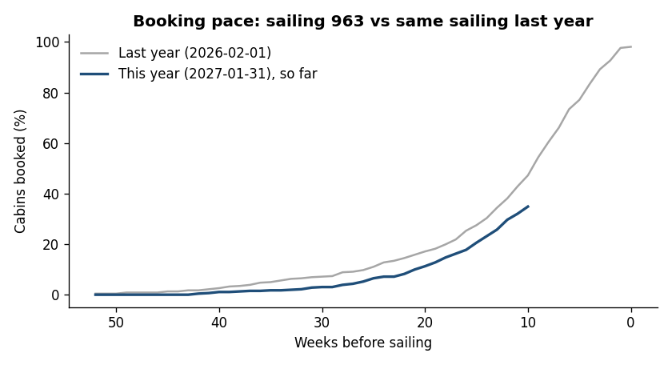

# Cruise Cabin Pricing & Demand Forecasting

An end-to-end revenue management project for a cruise line:
- an ETL pipeline that cleans 500K bookings,
- a SQL reporting layer,
- an XGBoost demand forecast that beats a "last year's pace" baseline,
- a pricing A/B test with CUPED variance reduction and a power analysis,
- price recommendations for upcoming sailings,
- Power BI-ready tables, and a weekly automated refresh.

> **Data note:** all data is **synthetic**, generated by `src/generate_data.py` to behave like real cruise demand (seasonality, booking curves, dynamic pricing, cancellations). It isn't real data from any cruise line, and the project isn't affiliated with any company.

## Results

| | Result |
|---|---|
| Data cleaned | **512,207 raw → 511,119 clean bookings**: 1,018 duplicates and 70 invalid rows removed, 2,555 category labels standardized, 511 missing prices filled |
| Demand forecast (backtest on the last 6 months of sailings) | **3.9% MAPE vs 10.4%** for the last-year-pace baseline (**62% lower error**) |
| Forecast 180 days out | **5.2% vs 22.1%** MAPE. The model's advantage grows with the forecast horizon |
| Pricing A/B test (+5% price when a cabin category is ≥70% booked at 60 days) | **No significant lift**: CUPED −0.83%, 95% CI −2.5% to +0.8%, p = 0.33. Decision: don't roll out broadly |
| Variance reduction | **CUPED cut variance by 95%**. The minimum detectable lift is about 2.4% with 300 sailings |
| Pricing insight (SQL) | After controlling for cabin mix, last-minute guests on **peak** sailings pay ~7% more than early bookers, while **low-season** last-minute fares are ~5% lower |
| Recommendations | Each of the next 180 days' sailings × cabin categories: *raise price / hold / promote* |





## How it works

```
generate_data ─▶ data/raw/*.csv
      │
      ▼
etl (pandas) ─▶ data/clean/*.parquet  ─▶ (optional) S3 + Athena
      │              partitioned by sail_year
      ├─▶ sql_reports (DuckDB SQL on Parquet) ─▶ occupancy, customer acquisition, price by booking window
      ├─▶ features ─▶ forecast (baseline vs XGBoost, time-based backtest) ─▶ forecast + recommendations
      ├─▶ experiment (A/B test, CUPED, power analysis)
      └─▶ export_powerbi + figures ─▶ outputs/powerbi/*.csv, outputs/figures/*.png
```

### 1. Data (`src/generate_data.py`)
The generator covers 4 ships and 1,091 sailings (Jan 2024–Jun 2027), with a snapshot date of 2026-11-20. Sailings after that date are only partly booked, just like the real world.

**Demand:**
- seasonality: peaks in Mar, Jun–Jul and Dec; lows in Sep–Oct
- holiday weeks
- year-over-year growth

**Booking curve:** the gap between booking and sailing follows a gamma distribution. Suites and 7-night cruises book earlier.

**Dynamic pricing:** strong sailings get pricier close to departure, and weak ones get discounted.

**Other details:**
- promotions: Wave season, Black Friday, past guests
- channels and source markets
- cancellations, which vary by channel

**Deliberately messy data, to test the ETL:** duplicates, missing and negative prices, bookings dated after the sailing, and inconsistent category text.

### 2. ETL (`src/etl.py`)
Extracts the raw CSVs, then runs validation rules. Each rule's count is logged to `outputs/data_quality_report.md`:
- dedupe
- standardize text
- drop impossible dates and non-positive prices
- fill missing prices with the sailing×category median, falling back to the category median, and flag them

The clean data is loaded as Parquet, including a copy **partitioned by `sail_year`**, which is the layout Athena reads from S3.

### 3. SQL layer (`sql/`, `src/sql_reports.py`)
SQL runs directly on the Parquet files with **DuckDB**. The same queries run in **AWS Athena** (`aws/athena_setup.sql`).

| Query | What it shows |
|---|---|
| `occupancy_by_sailing.sql` | Occupancy and revenue per available cabin |
| `customer_acquisition.sql` | New vs repeat guests, revenue and cancellations by channel and market |
| `price_by_booking_window.sql` | A price index within each sailing and cabin, which avoids a Simpson's paradox in the raw averages |

### 4. Demand forecast (`src/features.py`, `src/forecast.py`)
**What a row is:** one sailing × cabin category, at a horizon of 7, 14, 30, 60, 90, 120 or 180 days before sailing.

**Features:**
- cabins **on the books** at that point, adjusted for cancellations
- the same sailing **last year** (on-the-books and final)
- pace vs last year
- average price so far
- capacity, cabin, ship, nights
- month, week, holiday

**Baseline:** last year's pace (`on-the-books × last year's final ÷ last year's on-the-books`).

**Model:** XGBoost predicting final occupancy.

**Backtest:** trained on older sailings and tested on the most recent 6 months. There's a **180-day gap** between train and test, so the model never learns from outcomes that wouldn't have been known yet when a test forecast was made.

**Output:** `outputs/forecast_open_sailings.csv` holds a forecast and a recommendation for every open sailing in the next 180 days:
- ≥97% forecast occupancy: raise price
- ≤85%: promote
- otherwise: hold

### 5. Pricing A/B test (`src/experiment.py`)
**Rule:** raise a category's price 5% when it's ≥70% booked 60 days out.

**Design:**
- Randomized **by sailing**, so guests on the same sailing never see two prices for one cabin.
- Main metric: revenue per available cabin.
- Guardrail: occupancy.

**Analysis:**
- Welch t-test and a bootstrap confidence interval.
- **CUPED**, using revenue already on the books at day 60 as the covariate.
- A **power analysis**: the minimum detectable effect, and the sailings needed to detect +0.5%, which is about 3,300 per arm.

**Honest limits:** the demand response is **simulated** (assumed elasticity around −0.9, plus "spill" demand on sold-out sailings). This demonstrates the method; a real lift needs a live test.

**Result:** no significant lift. Late bookings are only about 16% of revenue, and a 5% increase mostly trades bookings for price. The recommendation is to test a larger price step only on categories forecast to sell out.

### 6. Power BI (`powerbi/`)
`python -m src.pipeline` writes a star schema to `outputs/powerbi/`:
- fact tables: bookings, inventory
- dimensions: sailing, ship, date
- forecast, pace curves, backtest and experiment tables, plus the SQL report outputs

`powerbi/BUILD_GUIDE.md` lists the pages to build, and `powerbi/MEASURES.md` has the DAX measures (occupancy, RevPAC, YoY, cancellation rate).

### 7. Cloud (`aws/`)
1. `aws/upload_to_s3.py --bucket <your-bucket>` uploads the partitioned Parquet files.
2. `aws/athena_setup.sql` creates the Athena tables and runs example queries.

This requires your own AWS account (the free tier is enough).

### 8. Automation
`src/pipeline.py` runs everything and logs to `logs/pipeline.log`.

`.github/workflows/weekly_refresh.yml` runs the tests and the pipeline **every Monday**, and uploads the forecast and charts as artifacts.

## Run it

```powershell
python -m venv .venv
.\.venv\Scripts\Activate.ps1
pip install -r requirements.txt
python -m pytest -q          # 8 tests
python -m src.pipeline       # about 15 seconds
```

## Project structure
```
src/        generate_data, etl, sql_reports, features, forecast, experiment, export_powerbi, figures, pipeline, config
sql/        SQL reports (DuckDB locally, Athena in the cloud)
aws/        S3 upload + Athena DDL
powerbi/    dashboard build guide + DAX measures
tests/      unit tests for cleaning, on-the-books logic and error metrics
outputs/    results, figures, Power BI tables (regenerated by the pipeline)
```

## Limitations and next steps
- **Synthetic data is cleaner than reality.** Real forecast error would be higher. Month and holiday dominate feature importance because the generator builds seasonality in directly.
- **The demand response in the A/B test is assumed.** Next steps:
  - Estimate price elasticity from historical price changes.
  - Use the model's forecast as the CUPED covariate (CUPAC) to cut variance further.
- **Next model steps:**
  - prediction intervals (quantile regression), so recommendations account for uncertainty
  - competitor prices and marketing spend as features
  - a price optimizer that picks the revenue-maximizing price per category
